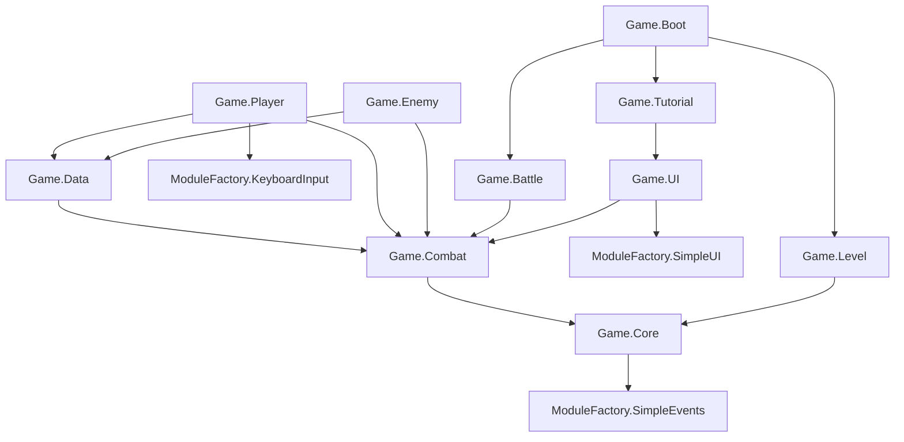
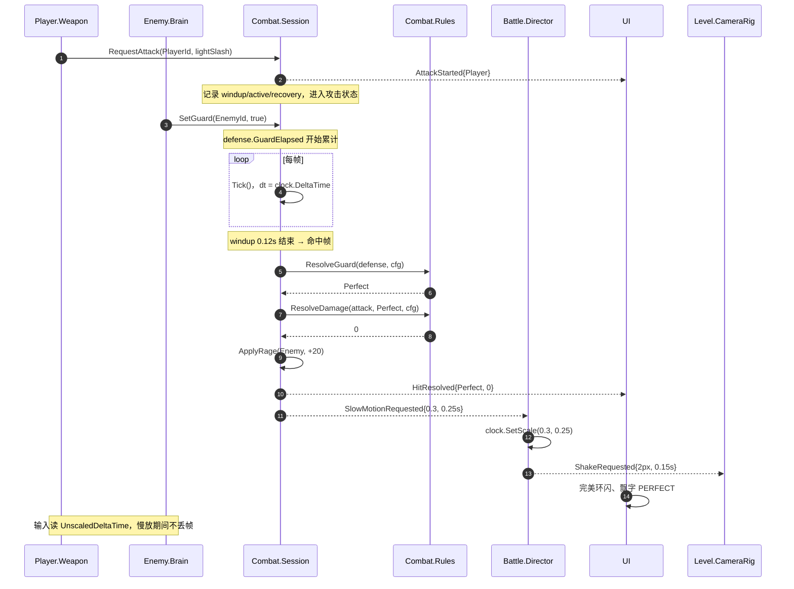
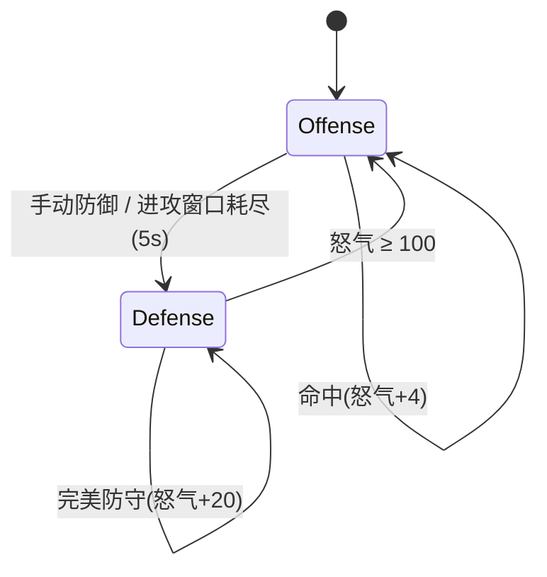
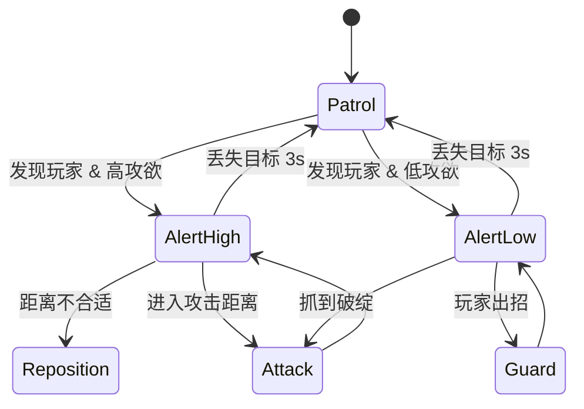
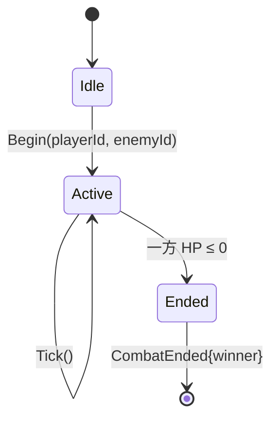

# GuangHeCup —— 2D 横版像素战斗 · 架构设计 v0.2

2026-11-23 · **设计文档，尚未改动 Unity 工程**

来源：`系统.xmind`（6 大系统）+ 工程实测结构。
配套文档：`BALANCE.md`（初版数值）、`ART_SPEC.md`（像素规格）。

---

## 0. 这次改了什么（v0.1 → v0.2）

- 新增 **术语表**：导图里的中文词与代码名一一对应，避免"索敌"在代码里出现三种拼写。
- 新增 **两张时序图 + 三张状态机图**：把"一次交手"和"攻防转换"画到函数调用级别。
- 收紧了事件边界：`Combat` 不再直接依赖 `SimpleEvents`，改由 `Game.Core` 暴露 `IGameEvents` 门面。Combat 现在**只依赖 Core**。
- 新增 **场景/Prefab 层级树**、**输入映射表**、**反模式清单**。
- 数值与美术规格拆到独立文档，本文件只谈结构。

---

## 1. 设计原则

1. **模块 = asmdef + 命名空间 + 公开 API + README + 测试**。只有文件夹不算模块。
2. **依赖单向**：`Combat` 是规则核心，`Player`/`Enemy` 实现它的接口，`Battle` 只认识接口，`UI` 只订阅事件。
3. **规则纯 C#，表现用 Unity**。判定逻辑不继承 `MonoBehaviour`、不读 `Time`/`Input`/`Transform`，可在 EditMode 裸跑。
4. **数据驱动 + 单一数据源**：帧数据（前摇/判定/后摇/伤害/完美窗口）只有一份，动画与判定同源。
5. **资源按玩法域分，代码按模块分**，两者不混放。
6. **跨模块通信只走两种通道**：`Game.Core` 的事件门面，或模块的公开接口。禁止直接引用他人内部类型。

---

## 2. 现状与约束

| 项 | 现状 | 影响 |
|---|---|---|
| Unity | 2022.3.62f2c1 | asmdef 用 name 引用、Test Framework 1.1.33 |
| 渲染 | Built-in RP | 像素风够用；要 2D 光照/法线才需 URP 2D |
| 输入 | Input System 1.6.1，新旧都启用 | 走 `KeyboardInput`，不碰旧 `Input` |
| 2D 能力 | pixel-perfect 5.1.0、aseprite 1.1.9、2d.animation 9.2.0、tilemap extras 3.1.3 | 管线齐了，不用装包 |
| 现有代码 | `Assets/Scripts/Shared/ModuleFactory.*`（6 个通用模块） | 可复用，但**不往里加玩法** |
| 现有输入资产 | `KeyboardActions.inputactions` 只有 Move/Interact/Pause/Navigate/Submit/Cancel | 需要**新建**本项目自己的 actions，不改共享样板 |
| 场景 | 仅 `SampleScene` | 需要 Boot / Battle / Sandbox |
| 测试 | `Assets/Tests/<Module>/{Runtime,Editor}` | 沿用同样布局 |

**玩法模块另开 `Game.` 家族，不复用 `ModuleFactory.` 前缀**：前者是本作，后者是工具箱。这个边界决定以后能不能把工具箱拿去下一个项目。

---

## 3. 术语表（导图 → 代码）

| 导图用语 | 代码名 | 所在模块 |
|---|---|---|
| 进攻形 / 防守形 | `Stance.Offense` / `Stance.Defense` | Combat |
| 攻防转换 | `StanceTransition` / `StanceChanged` | Combat |
| 先后手判定 | `Initiative` / `ResolveInitiative` | Combat |
| 攻击命中判定 | `HitResolution` / `HitResolved` | Combat |
| 防守 / 完美防守 | `GuardOutcome.Guarded` / `.Perfect` | Combat |
| 完美环 | `DefenceRing`（UI 组件） | UI |
| 怒气值 | `Rage` | Combat |
| 索敌 | `Alert`（`AlertHigh` / `AlertLow`） | Enemy |
| 巡逻 | `Patrol` | Enemy |
| 锁定 | `LockOn` | Battle |
| 全局慢放 | `SlowMotion` / `IGameClock.SetScale` | Core / Battle |
| 顿帧 | `HitStop` / `IGameClock.PushHitStop` | Core |
| 复活 / 重置 | `Checkpoint` / `Respawn` | Level |
| 教学指引 | `TutorialStep` | Tutorial |

**统一口径**：代码里只出现右列写法。中文注释可以写"完美防守"，但类型名、事件名、字段名一律英文，且这张表就是唯一映射。

---

## 4. 模块地图

| 导图系统 | 模块（asmdef） | 职责 | M1 必须 |
|---|---|---|---|
| 2. 战斗规则 | `Game.Combat` | 先后手、命中、伤害、防守/完美防守、攻防转换、怒气、慢放请求 | ✅ |
| 1. 玩家/武器 | `Game.Player` | 移动跳跃、普攻、换武器、防御输入、受击表现 | ✅ |
| 3. 敌人/AI | `Game.Enemy` | 巡逻 / 高攻欲 / 低攻欲 → 产生意图 | ✅ |
| — | `Game.Battle` | 锁定、驱动 Combat 时钟、胜负、慢放执行、震屏转发 | ✅ |
| — | `Game.Core` | 时钟、事件门面、进度存档 | ✅ |
| — | `Game.Data` | ScriptableObject + 映射为规则层 POCO | ✅ |
| 4. UI/VFX | `Game.UI` | 血条、完美环、攻防形态、索敌提示、计时 | 阶段二 |
| 5. 关卡 | `Game.Level`(+`.Editor`) | 地图、相机、复活重置、解锁门 | 阶段二 |
| 6. 教学指引 | `Game.Tutorial` | 分步引导 | 阶段三 |
| — | `Game.Boot` | 唯一可引用全部模块的装配层 | 阶段二 |

**敌人 AI 不在 Combat 里**：敌人只产出意图（我要攻击 / 我要防御 / 我后撤），Combat 负责裁决。三个状态机怎么写都改不到规则层。

---

## 5. 目录结构

```text
Assets/
├─ Scenes/
│  ├─ Boot.unity                    # 空场景，只挂装配与转场
│  ├─ Battle_01.unity               # 关卡场景
│  └─ Sandbox_Combat.unity          # 灰盒调试，不进 Build Settings
├─ Scripts/
│  ├─ Shared/                       # 现有工具箱，不动
│  └─ Game/
│     ├─ Core/
│     │  └─ Runtime/                # Game.Core.asmdef
│     │     ├─ Time/                #   IGameClock, GameClock, HitStop
│     │     ├─ Events/              #   IGameEvents, GameEventHub, 公共事件
│     │     ├─ Progress/            #   IProgressStore, PlayerPrefsProgress
│     │     └─ Services/            #   GameServices
│     ├─ Combat/
│     │  ├─ Runtime/                # Game.Combat.asmdef
│     │  │  ├─ Contracts/           #   ICombatant, ICombatWorld
│     │  │  ├─ Model/               #   AttackProfile, DefenseState, CombatConfig
│     │  │  ├─ Rules/               #   CombatRules（纯函数）
│     │  │  ├─ Session/             #   CombatSession, StanceController
│     │  │  └─ Events/              #   HitResolved, StanceChanged...
│     │  └─ Editor/                 # Game.Combat.Editor.asmdef（状态调试窗口）
│     ├─ Data/
│     │  └─ Runtime/                # Game.Data.asmdef
│     │     ├─ Weapons/  Enemies/  Combat/  Levels/
│     ├─ Player/
│     │  └─ Runtime/                # Game.Player.asmdef
│     │     ├─ Movement/  Weapon/  Defence/  Presentation/
│     ├─ Enemy/
│     │  └─ Runtime/                # Game.Enemy.asmdef
│     │     ├─ Perception/  States/  Presentation/
│     ├─ Battle/
│     │  └─ Runtime/                # Game.Battle.asmdef
│     │     ├─ BattleDirector.cs
│     │     ├─ LockOn/  SlowMotion/  Feedback/
│     ├─ UI/
│     │  └─ Runtime/                # Game.UI.asmdef
│     │     ├─ Hud/  DefenceRing/  Stance/  EnemyAlert/
│     ├─ Level/
│     │  ├─ Runtime/                # Game.Level.asmdef
│     │  │  ├─ CameraRig/  Checkpoint/  Gates/  Spawning/
│     │  └─ Editor/                 # Game.Level.Editor.asmdef（地图编辑器）
│     ├─ Tutorial/
│     │  └─ Runtime/                # Game.Tutorial.asmdef
│     └─ Boot/
│        └─ Runtime/                # Game.Boot.asmdef
├─ Game/                            # 玩法资源，唯一根目录
│  ├─ Art/ {Characters,Enemies,Environment,Tiles,VFX,UI}/
│  ├─ Audio/ {Music,SFX}/
│  ├─ Data/ {Weapons,Enemies,Combat,Levels}/
│  ├─ Prefabs/ {Player,Enemy,Weapons,FX,UI,Level}/
│  └─ Settings/                     #   GameplayActions.inputactions、渲染配置
└─ Tests/
   └─ Game/
      ├─ Combat/       # EditMode：先后手/命中/完美防守/攻防转换/慢放
      ├─ Battle/       # EditMode：锁定切换、胜负
      └─ Player/       # PlayMode：移动/跳跃
```

`Assets/Game/` 是资源的唯一根。不再出现顶层 `Assets/Prefabs`、`Assets/Art`——按文件类型摊平之后，找东西只能靠搜索框。

---

## 6. 程序集依赖



引用矩阵（行 = 引用方，✅ = 允许）：

|  | Core | Combat | Data | Player | Enemy | Battle | UI | Level | Tutorial |
|---|---|---|---|---|---|---|---|---|---|
| Core | – |  |  |  |  |  |  |  |  |
| Combat | ✅ | – |  |  |  |  |  |  |  |
| Data | ✅ | ✅ | – |  |  |  |  |  |  |
| Player | ✅ | ✅ | ✅ | – |  |  |  |  |  |
| Enemy | ✅ | ✅ | ✅ |  | – |  |  |  |  |
| Battle | ✅ | ✅ |  |  |  | – |  |  |  |
| UI | ✅ | ✅ |  |  |  |  | – |  |  |
| Level | ✅ |  |  |  |  |  |  | – |  |
| Tutorial | ✅ |  |  |  |  |  | ✅ |  | – |

四条硬规则：

- `Player` 与 `Enemy` **互不引用**，互动只经 Combat 事件。
- `Combat` **不得**引用 `Data`/`Player`/`Enemy`/`UI`，也**不引** `SimpleEvents`（走 `IGameEvents`）。
- `Level` 不引 `Combat`：震屏靠 Core 的 `ShakeRequested`，不靠认识战斗类型。
- 只有 `Boot` 可以引用全部，且 `Boot` 里不允许有玩法逻辑。

---

## 7. 数据流与时序

### 7.1 一次交手（玩家轻攻击 → 敌人完美防守）



要点：

- **Combat 不知道谁在演**。它只发事件；`Ui`、`CameraRig`、`Audio` 各自订阅。
- **慢放不由 Combat 执行**。Combat 只说"该慢放了"，`Battle` 决定缩放系数与时长（可被设置覆盖）。
- **同一帧内的先后手先于命中判定**：`ResolveInitiative` 决定谁先结算，再各自 `ResolveGuard`。

### 7.2 一帧内的固定顺序

```text
BattleDirector.Update()
 ├ 1. clock.Tick()                    // 推进时间、处理慢放回落
 ├ 2. 收集输入意图                     // Player 读输入、Enemy 状态机
 ├ 3. session.Tick()
 │     ├ a. 推进所有攻击的 windup/active/recovery
 │     ├ b. 到达 active 首帧 → ResolveInitiative 排序
 │     ├ c. 逐个结算 → ResolveGuard → ResolveDamage
 │     ├ d. 更新 HP / 怒气 / 形态 / 死亡
 │     └ e. Publish 事件（同步调用订阅者）
 └ 4. 表现层在事件回调里改动画/特效（本帧内完成，不延迟一帧）
```

**顺序固定，不依赖事件顺序的巧合。** 这是可测试性的前提：给同样的输入序列和 dt 序列，必须得到同样的结果。

---

## 8. 状态机

### 8.1 攻防转换（每个战斗单位一份）



设计意图：**进攻有代价（窗口会耗尽），防守有收益（攒怒气）**。两个方向都不是纯赚，逼玩家来回切。

### 8.2 敌人三态



**高攻欲 vs 低攻欲不是两套代码**，是同一个 `AlertState` 配不同的 `AggressionPreset`（缩进距离、出招概率、防御倾向、反应延迟）。这样加敌人类型只是加数据，不是加分支。

### 8.3 CombatSession 生命周期



一个 `CombatSession` = 一场单挑。一对多时由 `Battle` 决定"锁定哪一对"，不要在一个 Session 里塞多个敌人。

---

## 9. 公共 API 草案

### 9.1 `Game.Core`

```csharp
namespace Game.Core
{
    /// 游戏时间。慢放 / 顿帧只改这里。
    public interface IGameClock
    {
        float DeltaTime { get; }          // 受慢放影响，表现层用
        float UnscaledDeltaTime { get; }  // 真实时间，输入缓冲/UI 用
        float Scale { get; }
        void SetScale(float scale, float durationSeconds); // 到期自动回落
        void PushHitStop(float seconds);  // 顿帧，叠加、可被打断
    }

    /// 事件门面。Core 内部包一层 SimpleEvents.EventBus，外部只见这个接口。
    public interface IGameEvents
    {
        System.IDisposable Subscribe<T>(System.Action<T> handler) where T : struct;
        void Publish<T>(T message) where T : struct;
    }

    public interface IProgressStore
    {
        bool IsUnlocked(string id);
        void Unlock(string id);
        void Save();
    }

    /// Core 自己的事件：不依赖任何玩法模块，供 Level/UI 订阅。
    public readonly struct ShakeRequested
    {
        public readonly float Amplitude, Duration;
    }

    public readonly struct SlowMotionChanged
    {
        public readonly float Scale;
        public readonly bool Entering;
    }
}
```

### 9.2 `Game.Combat`

```csharp
namespace Game.Combat
{
    public readonly struct CombatantId : System.IEquatable<CombatantId>
    { public readonly int Value; }

    public enum Stance { Offense, Defense }
    public enum GuardOutcome { Hit, Guarded, Perfect }
    public enum InitiativeOutcome { AFirst, BFirst, Trade }

    public readonly struct AttackProfile
    {
        public readonly float Windup, Active, Recovery, Damage;
        public readonly int RageGain, Priority;
        public readonly bool Unblockable;
    }

    public readonly struct DefenseState
    {
        public readonly bool IsGuarding;
        public readonly float GuardElapsed;   // 自按下防御起
        public readonly bool JustPressed;     // 本帧是否新按下
    }

    public readonly struct CombatConfig
    {
        public readonly float PerfectGuardWindow;     // 见 BALANCE.md
        public readonly float GuardDamageMultiplier;
        public readonly float GuardRageGain, PerfectRageGain, HitRageGain;
        public readonly float OffenseWindow;
        public readonly int   RageToEnterOffense;
        public readonly float SlowMotionScale, SlowMotionDuration;
    }

    public static class CombatRules   // 纯函数，无状态，全部可单测
    {
        public static GuardOutcome ResolveGuard(in DefenseState def, in CombatConfig cfg);
        public static float ResolveDamage(in AttackProfile atk, GuardOutcome outcome, in CombatConfig cfg);
        public static InitiativeOutcome ResolveInitiative(in AttackProfile a, in AttackProfile b);
    }

    public interface ICombatWorld    // 由 Battle 实现，Combat 不反向依赖 MonoBehaviour
    {
        void ApplyDamage(CombatantId target, float amount, GuardOutcome outcome);
        void ApplyRage(CombatantId target, float amount);
        void SetStance(CombatantId who, Stance stance);
        void ReportDeath(CombatantId who);
    }

    public sealed class CombatSession : System.IDisposable
    {
        public CombatSession(CombatConfig cfg, ICombatWorld world,
                             Game.Core.IGameEvents events, Game.Core.IGameClock clock);
        public void RequestAttack(CombatantId who, in AttackProfile profile);
        public void SetGuard(CombatantId who, bool guarding);
        public void Tick();
        public void Dispose();
    }
}
```

事件（都是 struct，满足 `Subscribe<T> where T : struct`）：

```csharp
public readonly struct AttackStarted  { public readonly CombatantId Attacker; public readonly float Duration; public readonly bool Heavy; }
public readonly struct HitResolved    { public readonly CombatantId Attacker, Target; public readonly float Damage; public readonly GuardOutcome Outcome; public readonly bool Lethal; }
public readonly struct GuardBroken    { public readonly CombatantId Who; }
public readonly struct StanceChanged  { public readonly CombatantId Who; public readonly Stance From, To; public readonly bool Forced; }
public readonly struct RageChanged    { public readonly CombatantId Who; public readonly float Current, Max; }
public readonly struct SlowMotionRequested { public readonly float Scale, Duration; }
public readonly struct CombatEnded    { public readonly CombatantId Winner; }
```

### 9.3 `Game.Data`

```csharp
[CreateAssetMenu(menuName = "Game/Weapons/Weapon Definition")]
public sealed class WeaponDefinition : ScriptableObject
{
    public string id;
    public AttackProfileData normal;
    public AttackProfileData special;
}

[System.Serializable]
public struct AttackProfileData
{
    public float windup, active, recovery, damage;
    public int rageGain, priority;
    public bool unblockable;
    public AttackProfile ToProfile();
}
```

**为什么两层**：`AttackProfile` 是 `readonly struct`（不可序列化），`AttackProfileData` 是可序列化镜像。规则层永远拿不到 SO，测试直接 new 一个 POCO。

### 9.4 `Game.Player` / `Game.Enemy`

```csharp
// Player：输入 → 意图
public sealed class PlayerCombatant : MonoBehaviour   // 实现 ICombatant
{
    public void Bind(CombatSession session, WeaponDefinition weapon);
    public void SyncGuard();      // 每帧把防御输入同步给 Session
}

// Enemy：状态机 → 意图。不含任何伤害公式。
public sealed class EnemyBrain : MonoBehaviour
{
    [SerializeField] EnemyDefinition definition;
    // Patrol → AlertHigh/AlertLow → Attack/Guard/Reposition
    // 输出只有两件事：RequestAttack、SetGuard
}
```

### 9.5 `Game.Battle`

```csharp
public sealed class BattleDirector : MonoBehaviour, ICombatWorld
{
    public static BattleDirector Instance { get; }
    public CombatSession Session { get; }
    public CombatantId PlayerId { get; }
    public CombatantId CurrentTarget { get; }   // 锁定目标
    public void LockOn(CombatantId target);
    public void ClearLock();
}
```

`BattleDirector` 是场景里**唯一**的 `Update` 驱动者：推进时钟、调 `Session.Tick()`、把 `HitResolved` 翻译成 `ShakeRequested`。

### 9.6 `Game.UI` / `Game.Level` / `Game.Tutorial`

```csharp
// UI 只订阅，不算数值
events.Subscribe<HitResolved>(e => ring.Flash(e.Outcome));
events.Subscribe<StanceChanged>(e => stanceView.Show(e.To));
events.Subscribe<RageChanged>(e => stanceView.SetRage(e.Current / e.Max));

// Level 不认识 Combat
events.Subscribe<ShakeRequested>(e => rig.Shake(e.Amplitude, e.Duration));

// Tutorial 只读事件 + 调 UI
public sealed class TutorialStep { public string id, text; public System.Func<bool> IsSatisfied; }
```

---

## 10. 场景与 Prefab 层级

### 10.1 `Battle_01.unity`

```text
Battle_01
├─ Systems
│  ├─ GameEventHub          # GameEventHub : IGameEvents
│  ├─ GameClock             # GameClock : IGameClock
│  ├─ AudioRoot             # ModuleFactory.Audio
│  └─ UIRoot (Canvas)       # UIManager + HUD 面板
├─ Level
│  ├─ Tilemap_Ground / Tilemap_Walls
│  ├─ Parallax_01..03
│  ├─ Checkpoints
│  ├─ Gates                  # WeaponGate
│  └─ EnemyGroups
├─ Player                    # Player.prefab 实例
├─ Enemies
└─ CameraRig
   └─ Main Camera (+ PixelPerfectCamera)
```

### 10.2 `Player.prefab`

```text
Player (Rigidbody2D, CapsuleCollider2D, PlayerCombatant, PlayerMotor, SpriteRenderer)
├─ Visual (Animator, SpriteRenderer)
├─ GroundCheck
├─ AttackHitbox (BoxCollider2D, disabled by default)
└─ CameraTarget
```

### 10.3 `Enemy.prefab`

```text
Enemy (Rigidbody2D, CapsuleCollider2D, EnemyBrain, EnemyCombatant)
├─ Visual (Animator, SpriteRenderer)
├─ Perception (视野 Shape/距离参数)
└─ AttackPoint
```

**约定**：碰撞体只做物理（地面、推挤），**不用 Trigger 做伤害判定**；伤害判定走 Combat 的显式重叠查询，确定性更好、也方便在测试里桩掉。

---

## 11. 输入映射

新建 `Assets/Game/Settings/GameplayActions.inputactions`，**不改** Shared 的 `KeyboardActions.inputactions`（那是共享样板，示例场景还在用）。

`Gameplay` map：

| Action | 键 | 类型 | 消费方 |
|---|---|---|---|
| `Move` | A / D | Value(Vector2/float) | Player.Movement |
| `Jump` | Space | Button | Player.Movement |
| `Attack` | J | Button | Player.Weapon |
| `HeavyAttack` | K | Button | Player.Weapon |
| `Guard` | L / Shift | Button(hold) | Player.Defence |
| `SwapWeapon` | Q | Button | Player.Weapon |
| `LockOn` | Tab | Button | Battle.LockOn |
| `Pause` | Esc | Button | UI |

`UI` map：`Navigate` / `Submit` / `Cancel`（与现有模块同名，暂停菜单直接复用 `KeyboardInput` 的菜单逻辑）。

---

## 12. 时间与慢放

| 情况 | 做法 |
|---|---|
| 暂停菜单 | `Time.timeScale = 0` + `GameAudio.Service.SetWorldPaused(true)`（音频模块已明确支持） |
| 全局慢放 | 只经 `IGameClock.SetScale`，玩法读 `DeltaTime`，**不写 `Time.timeScale`** |
| 顿帧 | `PushHitStop(seconds)`，独立于慢放，可叠加、可被打断 |
| UI、输入缓冲 | 读 `UnscaledDeltaTime`，慢放时仍然跟手 |
| 音频 | 播放速度不跟随慢放（音高不变） |
| 动画 | `animator.speed = clock.Scale`，由表现层统一设置，各组件不各改各的 |

**判定时钟口径（待定，见 §16）**：目前按 **game time** 写设计——慢放时完美防守窗口同步变宽，符合子弹时间直觉。若改成 real time，只需换 `CombatSession` 注入的时钟，规则函数不动。

---

## 13. 命名约定

| 对象 | 约定 | 例 |
|---|---|---|
| asmdef | `Game.<Area>`，放模块根目录 | `Game.Combat` |
| 命名空间 | 与 asmdef 同名 | `namespace Game.Combat` |
| 文件夹 | PascalCase，按领域不按类型 | `Runtime/Rules/`、`Runtime/Events/` |
| 事件 | 过去式 | `HitResolved`、`StanceChanged` |
| 规则函数 | `Resolve*` | `ResolveGuard` |
| SO 菜单 | `Game/<域>/<类型>` | `Game/Weapons/Weapon Definition` |
| 测试 asmdef | `<Module>.Tests` / `<Module>.Editor.Tests` | 同 `ModuleFactory.Audio.Tests` |

---

## 14. 反模式清单（代码评审直接对照）

- ❌ UI 里自己算伤害、自己判完美防守 → 只订阅事件。
- ❌ Animator 里手填攻击判定帧 → 帧数据来自 `AttackProfile`。
- ❌ `Player` 直接 `GetComponent<Enemy>()` → 经 Combat 接口/事件。
- ❌ 用 `Time.timeScale` 做慢放 → 走 `IGameClock`。
- ❌ `ScriptableObject` 传进 Combat → 先映射成 POCO。
- ❌ 一个状态一个 asmdef → 模块按职责分，状态是类不是程序集。
- ❌ `BattleDirector` 里写伤害公式 → 公式只在 `CombatRules`。
- ❌ 用 Trigger 回调做命中 → 用显式重叠查询。
- ❌ 事件订阅不 Dispose → 统一在 `OnDisable` 里 Dispose，或用 `CancellationToken`。

---

## 15. 里程碑与验收

| 阶段 | 内容 | 验收标准 |
|---|---|---|
| **M0 骨架** | 目录、asmdef、空接口；不动现有代码 | 编译零错误；`Assets/Tests/Game` 有 1 个空测试跑绿 |
| **M1 规则** | `CombatRules` + `CombatSession` + 全部 EditMode 测试 | 先后手/命中/普通防守/完美防守/攻防转换/怒气 6 组用例全绿；无场景可跑 |
| **M2 灰盒** | 玩家移动跳跃、一个敌人巡逻+索敌、完整交手（无美术） | 能打掉敌人、能被打、能完美防守；手感可用 |
| **M3 表现** | Animator、闪白、顿帧、震屏、UI、音效 | 与 M2 判定完全一致；UI 无自算数值 |
| **M4 关卡** | Tilemap、相机、复活重置、解锁门、编辑窗口 | 死后从检查点重来；门随解锁开 |
| **M5 打磨** | 教学、特效、数值调优、第二把武器 | 新手不看文档能打出完美防守 |

M1 最值得先做：规则层有测试之后，后面所有美术和手感调整都在安全网里进行。

---

## 16. 待你拍板的决策

| # | 决策 | 影响 | 我的建议 |
|---|---|---|---|
| 1 | **判定时钟**：完美防守窗口按 game time 还是 real time？ | M1 测试写法 | game time（慢放窗口变宽） |
| 2 | **战斗形态**：单挑锁定，还是一对多？ | `CombatSession` 是单场还是多场并行 | 先单挑，一对多靠多个 Session |
| 3 | **PPU 与参考分辨率**：32 PPU / 480×270？ | 所有美术规格 | 见 `ART_SPEC.md` |
| 4 | **2D 光照**：Built-in 够用，还是切 URP 2D？ | 会动所有材质 | 先 Built-in，夜景再说 |
| 5 | **地图编辑**：Tilemap + 自定义窗口，还是外部 Tiled？ | Level 模块工作量 | Tilemap + 窗口 |

---

## 17. 落地清单

**M0 已完成（2026-11-23）**：目录树、13 个 asmdef、全部 `.meta` 已落到工程里（见 §5、§6）；Unity 侧等首次导入确认。

后续按序：

1. 写 `CombatRules` 纯函数 + EditMode 测试（先红后绿）。
2. 写 `CombatSession.Tick`，补 4 个测试：完美窗口边界、同帧先后手、攻防转换、怒气累积。
3. 建 `Sandbox_Combat.unity`：两个灰盒 + 调试窗口，验证判定。
4. 接 `Player` 输入与 `Enemy` 状态机。
5. 建 `Boot.unity` / `Battle_01.unity` 与装配层（`Game.Boot`）。

**关于 asmdef 数量**：原先建议先合并 `Player`+`Enemy`+`Battle`，实际骨架阶段一次性建全了 13 个——空程序集零编译成本，而"先合并后拆"要改所有引用、还要换文件名。边界既然已经在 §6 定死，就直接用终态命名。代码仍按上面的顺序填，`Game.Combat` 先成型，`Player`/`Enemy`/`Battle` 空壳先放着。

---

## 附录 A：asmdef 模板

```json
{
  "name": "Game.Combat",
  "rootNamespace": "Game.Combat",
  "references": ["Game.Core"],
  "includePlatforms": [],
  "excludePlatforms": [],
  "allowUnsafeCode": false,
  "overrideReferences": false,
  "autoReferenced": false
}
```

```json
{
  "name": "Game.Combat.Tests",
  "references": ["Game.Combat"],
  "includePlatforms": ["Editor"],
  "optionalUnityReferences": ["TestAssemblies"]
}
```

纯规则测试走 EditMode，`includePlatforms: ["Editor"]`，与现有 `ModuleFactory.SimpleEvents.Editor.Tests` 一致。

## 附录 B：与现有 Shared 模块的对接点

| 现有模块 | 用在哪 | 对接方式 |
|---|---|---|
| `ModuleFactory.KeyboardInput` | 攻击/防御/换武器/移动 | `KeyboardActionSet.GetGameplayAction("Attack").SubscribePerformed(...)` |
| `ModuleFactory.SimpleEvents` | 事件底层 | 由 `GameEventHub` 包成 `IGameEvents`，玩法层不直接用 |
| `ModuleFactory.SimplePool` | 特效、飘字、投射物 | `Spawn/Despawn/DespawnAfter` |
| `ModuleFactory.SimpleUI` | HUD、暂停、转场 | `UIManager.Open/Close`，面板挂 `UIPanel` |
| `ModuleFactory.SceneFlow` | 关卡切换、死亡重载 | `SceneFlowLoader.TryLoad(scenePath)` |
| `ModuleFactory.Audio` | 打击音、音乐、慢放音 | `GameAudio.PlayAt(cue, pos)`；暂停 `SetWorldPaused(true)` |

## 附录 C：像素风硬约束

详见 `ART_SPEC.md`，此处只列必守三条：

- 全项目统一 PPU 与参考分辨率，写进文档后不再改。
- Sprite 导入：Filter = Point、Compression = None、Mip Maps = off。
- 所有缩放/位移取整数像素；UI 用 Pixel Perfect 模式。
